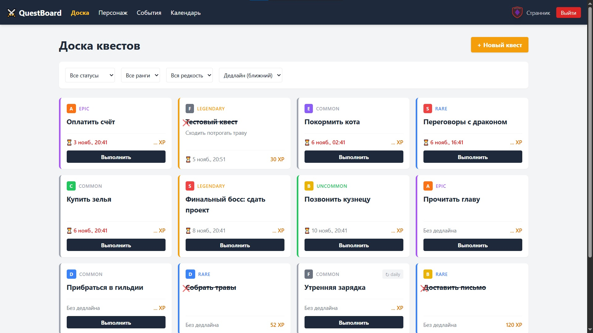
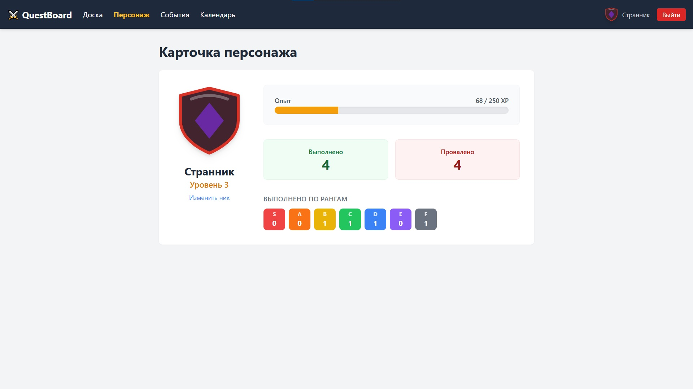
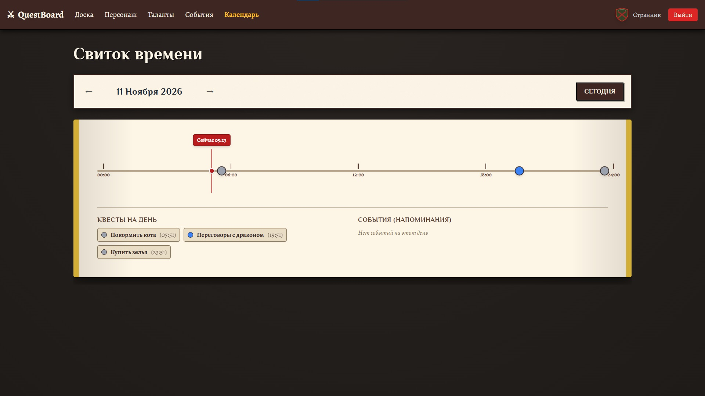
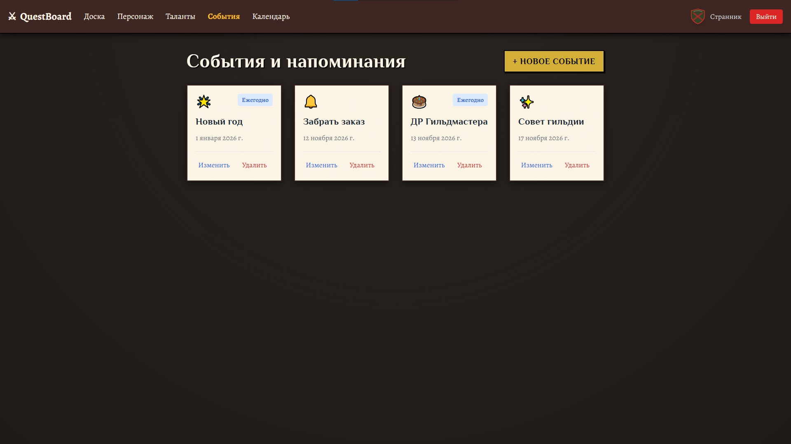

# Quest Board RPG
[](https://github.com/ttWhithe/Quest-Board-RPG/actions/workflows/ci.yml)

RPG-трекер задач в стилистике доски квестов средневековой магической гильдии.
Задания имеют ранг сложности (S–F) и редкость-срочность (common–legendary), начисляют XP,
формируют персонажа пользователя и отображаются на временной шкале.

**Демо-режим:** «Войти как гость» — без регистрации, с засеянными квестами и событиями.

## ✨ Features

- ⚔️ **RPG-механика**: Квесты с рангами сложности (S-F) и редкостью (common-legendary). Начисление XP и рост уровня.
- 📜 **Свиток времени**: Визуализация дедлайнов и событий на 24-часовой шкале с линией «сейчас».
- 🛡️ **Процедурный герб**: Уникальный SVG-герб для каждого игрока на основе seed-значения.
- 🎭 **События**: Дни рождения, праздники и напоминания с логикой ежегодного повторения.
- ⚡ **Умные статусы**: Система сама определяет просроченные квесты (`effective_status`).
- 🎨 **Плавный UI**: Анимации начисления опыта (Framer Motion) и адаптивный дизайн.

## 🖼 Скриншоты

| Доска квестов | Карточка персонажа |
| :---: | :---: |
| __ | __ |

| Свиток времени | События |
| :---: | :---: |
| __ | __ |

## Стек

- **Backend:** Python 3.12, FastAPI (async), SQLAlchemy 2.0, asyncpg, Alembic
- **БД:** PostgreSQL 16
- **Кэш / Rate Limit:** Redis 7
- **Frontend:** React 18 + TypeScript + Vite, TanStack Query, Tailwind CSS, react-i18next, Framer Motion
- **Тесты:** pytest (+ pytest-cov), Vitest
- **Качество кода:** ruff, mypy (strict), pre-commit
- **CI:** GitHub Actions
- **Запуск:** Docker + docker-compose

## 🚀 Быстрый старт

Требования: Docker 24+.

Теперь весь проект (БД, Redis, API и Frontend) упакован в Docker и запускается одной командой.

```bash
git clone https://github.com/ttWhithe/Quest-Board-RPG.git && cd Quest-Board-RPG

# Подготовить переменные окружения
cp .env.example .env

# Запустить сборку и старт всех контейнеров
docker compose up --build -d
```

- **Фронтенд:** http://localhost:5173
- **API (Swagger):** http://localhost:8000/docs

*(Для остановки используйте `docker compose down`)*

## 🌍 Деплой на VPS (Production)

Проект полностью готов к развертыванию на любом VPS (например, Timeweb, Beget, Reg.ru) с установленным Docker и Docker Compose.

**Инструкция по деплою:**

1. Арендуйте VPS с Ubuntu 22.04+ (минимум 1 vCPU, 1 GB RAM).
2. Установите Docker и Docker Compose на сервер:
   ```bash
   curl -fsSL https://get.docker.com | sh
   sudo usermod -aG docker $USER
   ```
3. Склонируйте проект на сервер:
   ```bash
   git clone https://github.com/ttWhithe/Quest-Board-RPG.git
   cd Quest-Board-RPG
   ```
4. Создайте файл `.env` и **обязательно** измените `JWT_SECRET` на надежный ключ (например, сгенерированный через `openssl rand -hex 32`):
   ```env
   POSTGRES_USER=questboard
   POSTGRES_PASSWORD=super_secret_password
   POSTGRES_DB=questboard
   JWT_SECRET=your_super_secret_jwt_key_here
   JWT_EXPIRES_DAYS=7
   CORS_ORIGINS=http://your-domain.com
   ```
5. Запустите проект в фоне:
   ```bash
   docker compose up --build -d
   ```
6. (Опционально) Настройте Nginx как Reverse Proxy на хосте для привязки домена и SSL-сертификата (Let's Encrypt).

После этого приложение будет доступно по IP-адресу вашего сервера (порт 5173).

## 📂 Структура

```text
Quest-Board-RPG/
├── backend/       # FastAPI + SQLAlchemy + Alembic
├── frontend/      # React + Vite + TypeScript
├── docs/          # Документация (ТЗ, дневник, промпты, скриншоты)
├── tools/         # Скрипты для запуска (.bat)
├── docker-compose.yml
├── .github/workflows/ci.yml
└── README.md
```

## 📚 Документация

- Полное ТЗ — [docs/spec.md](docs/spec.md)
- Хроника разработки — [docs/devlog.md](docs/devlog.md)

## 🗺 Roadmap

- i18n (RU/EN)
- Полный календарь-грид с пересечениями
- Достижения и стрики
- Drag & drop на доске
- Уведомления (email/push)
- Экспорт статистики
- История выполнений (`quest_completions`)
- Дерево талантов / Пассивные навыки (влияют на % получаемого XP).
- Процедурная карта подземелья / Путь героя.
- Кнопка «Поделиться прогрессом» (генерация красивого изображения персонажа).
- Кастомные иконки уровней (формы и цвета, зависящие от ранга).
- Детализированные SVG-символы гильдии внутри герба (дракон, рыцарь и т.д.).
- Загрузка пользовательского аватара (фотографии персонажа).

## Лицензия

MIT
